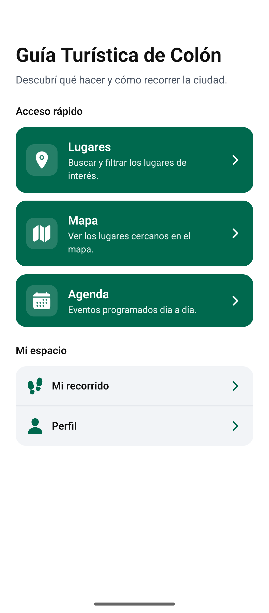
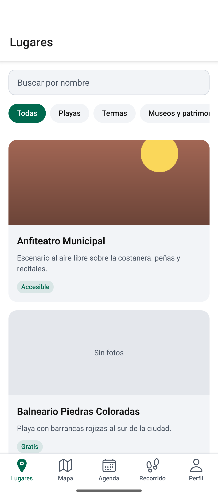
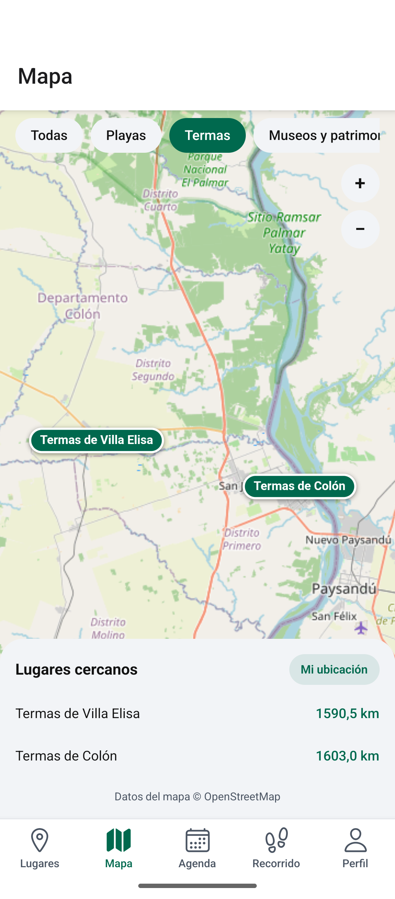
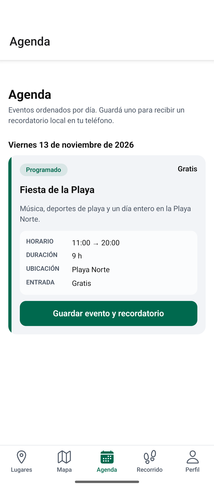
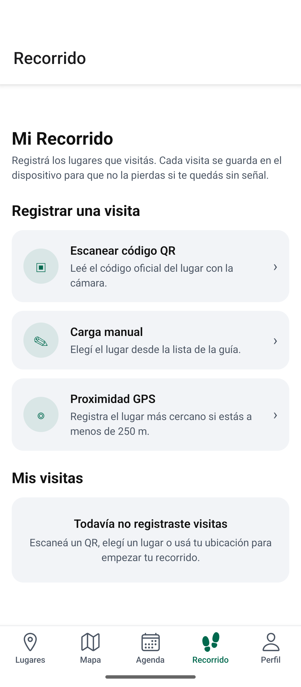
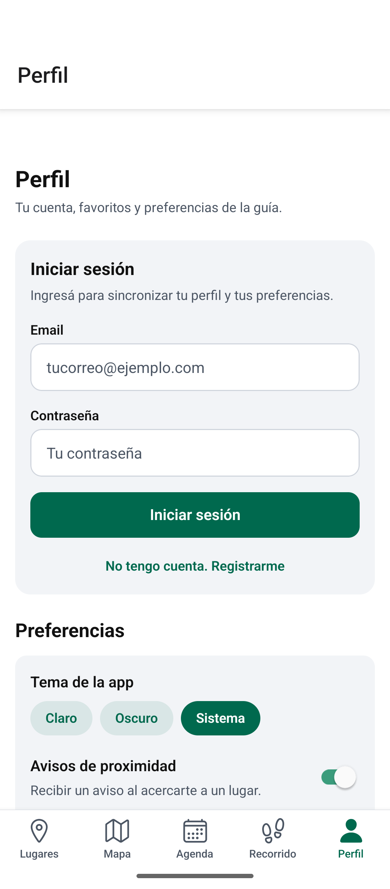
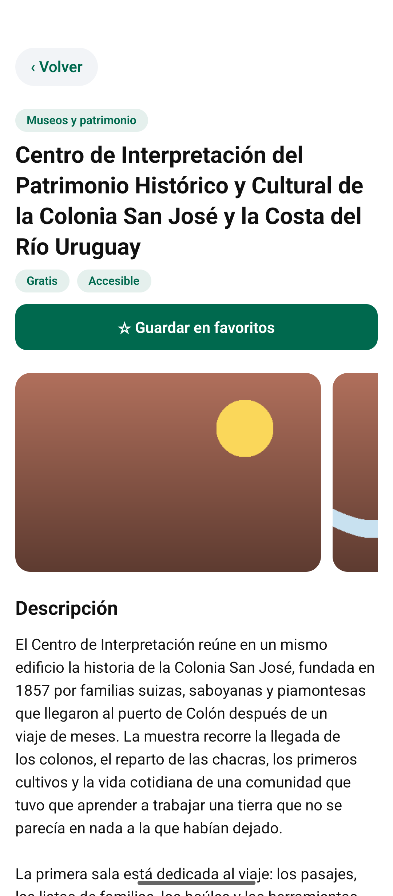
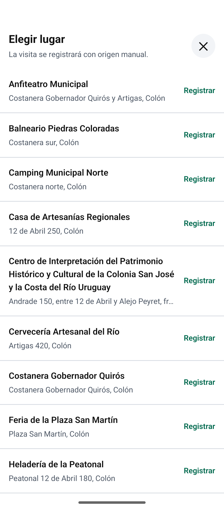

# Guía Turística de Colón

Aplicación móvil para turistas que visitan la ciudad de Colón (Entre Ríos): lugares de interés, mapa con lugares cercanos, agenda de eventos, registro de visitas, favoritos y audioguías, disponible en el teléfono incluso sin conexión.

---

## Vista previa

Capturas de la app en Android, con los datos de demostración:

| Inicio | Lugares | Mapa | Agenda |
|:---:|:---:|:---:|:---:|
|  |  |  |  |
| **Inicio** | **Lugares** | **Mapa** | **Agenda** |

| Mi recorrido | Perfil | Detalle de lugar | Registrar visita |
|:---:|:---:|:---:|:---:|
|  |  |  |  |
| **Mi recorrido** | **Perfil** | **Detalle de lugar** | **Registrar visita** |

---

## Funcionalidades (resumen)

- **Lugares**: listado de lugares de interés con filtros por categoría y búsqueda por nombre.
- **Mapa y cercanos**: mapa interactivo con la ubicación del usuario y los lugares a su alrededor.
- **Agenda**: eventos programados día a día, con detalle de fecha, precio y estado.
- **Mi recorrido**: registro de visitas por QR, proximidad GPS o carga manual, con fotos y notas.
- **Favoritos y cuenta**: guardado de favoritos y acceso con la cuenta del usuario.
- **Audioguías**: explicaciones de los lugares reproducibles desde la app.

## Requisitos previos

- **Node.js** 20 o superior (se recomienda la última versión LTS).
- **npm** (incluido con Node.js).
- Para probar la app en el teléfono: **Expo Go** instalado en el dispositivo (Android o iOS).
- Opcional: un **emulador de Android** (por ejemplo, Pixel 4 con AVD) o el simulador de iOS.
- Opcional: cuenta en [expo.dev](https://expo.dev) para builds con EAS.

## Guía de instalación

```bash
# 1. Clonar el repositorio
git clone <url-del-repositorio>
cd colon-app

# 2. Instalar dependencias
npm install
```

## Uso / Inicio rápido

```bash
# Iniciar el servidor de desarrollo de Expo
npm start
# o también:
npx expo start
```

Desde la terminal podés:

- Presionar **a** para abrir en un emulador Android.
- Presionar **i** para abrir en el simulador de iOS.
- Presionar **w** para abrir en el navegador (web).
- Escanear el **QR** que aparece en la terminal con la app **Expo Go** de tu teléfono (el teléfono debe estar en la misma red Wi-Fi que la computadora).

Verificación de tipos:

```bash
npm run typecheck
```

## Configuración

La app está preparada para consumir una API externa. La URL base se configura con una variable de entorno:

```
# Archivo .env (no se sube al repositorio)
EXPO_PUBLIC_API_URL=https://api.ejemplo.com/v1
```

- Las variables con prefijo `EXPO_PUBLIC_` son las únicas que quedan embebidas en la app en tiempo de build.
- Hasta que la API esté disponible, la aplicación funciona con datos locales de prueba (mocks).
- Nunca commitear archivos `.env` con claves o tokens; los datos sensibles siempre van en variables de entorno.